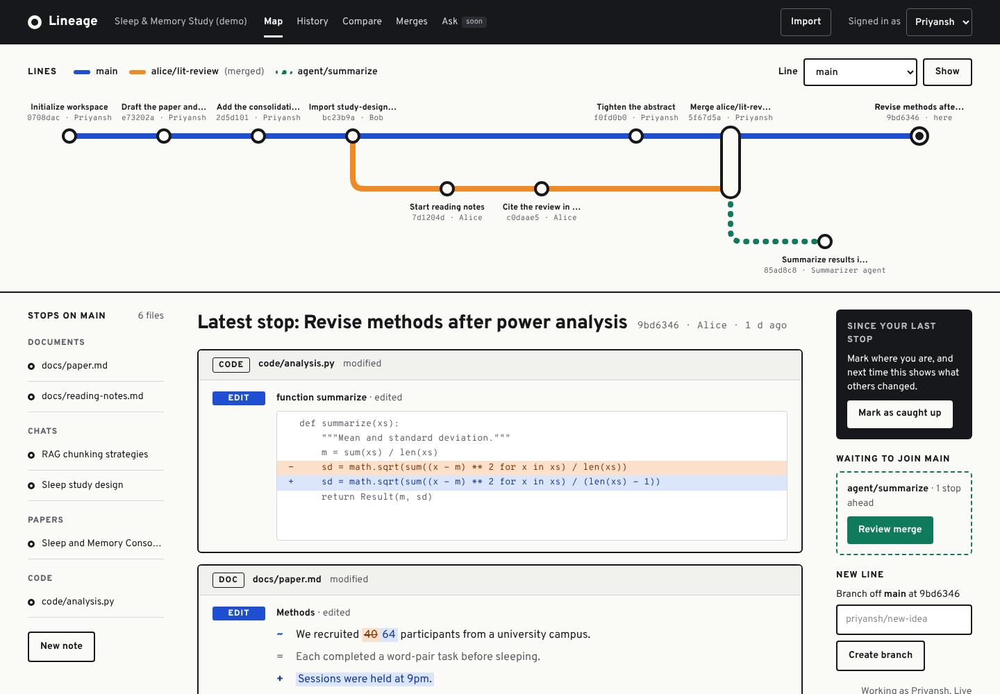
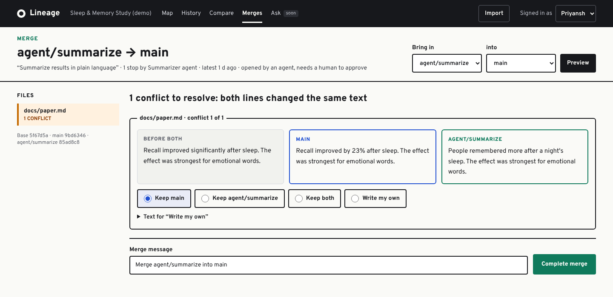
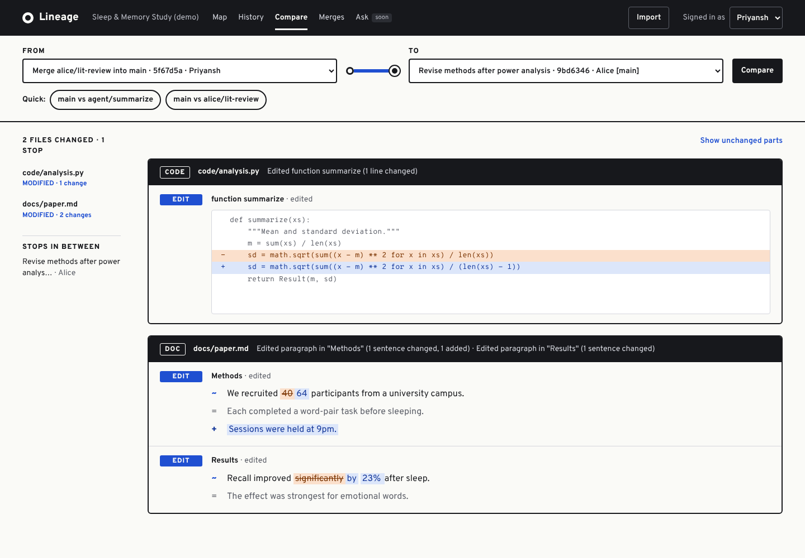
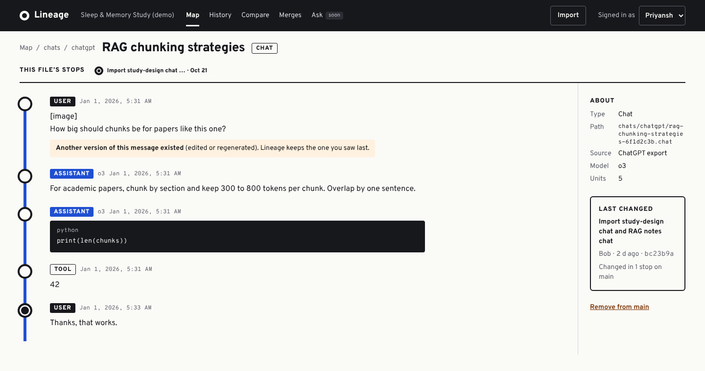
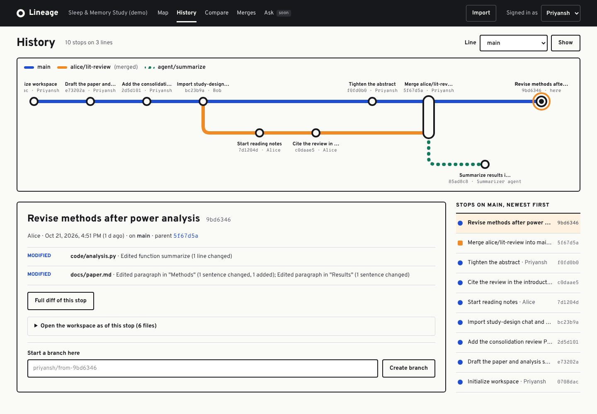

# Lineage

**Git for research.** Version docs, LLM chats, PDFs and code as first-class objects, with semantic diffs, branching, 3-way merge, real-time collaboration and "chat with your research history" at any point in time.

Research lives across Google Docs, PDF folders, repos and dozens of ChatGPT/Claude conversations that never get saved anywhere durable. There's no shared history, no diff, no branching, and no way for several people to work on the same body of knowledge without overwriting each other. Git solved this for code. Lineage applies the same model to research.

> Status: **Phase 3 of 6 done.** The versioning engine, ingestion and the web app work end to end on a local, file-backed store. Real-time editing, the hosted database and retrieval are next. See [Roadmap](#roadmap).



## Run it

```bash
pnpm install
pnpm build
pnpm dev          # http://localhost:3000
```

Click **Load demo workspace** for a small sleep study: a paper, a PDF, two imported AI chats, a Python script, a merged branch, and an agent branch with a real conflict waiting for review. Switch between Priyansh, Alice and Bob from the header to try concurrent work.

Data lives in `apps/web/.lineage/` (override with `LINEAGE_DATA_DIR`). Requires Node 22+ and pnpm 10.

## How it works

### 1. Everything becomes a `Doc` of units

Every artifact is normalized into an ordered list of **units**, the smallest thing a human would call "a change":

| Artifact | Unit |
|---|---|
| Markdown / text | heading, paragraph, list, quote, code block |
| ChatGPT / Claude export | one turn (`role` in meta) |
| PDF | paragraph (`page` in meta) |
| Code | symbol (function, class) via tree-sitter |

Diff, merge and search all work on units, not bytes. That's what makes the diffs readable.

### 2. Ingestion

`@lineage/ingest` turns uploads into docs. Each format gets its own parser, because the exports don't share a schema.

| Input | How it's parsed |
|---|---|
| **Markdown / text** | Block-level units: headings, paragraphs, lists, quotes, fenced code |
| **ChatGPT `conversations.json`** | Messages form a tree (edits and regenerations create siblings). The visible thread is rebuilt by walking from `current_node` up through parents. Hidden system messages and reasoning are dropped, images become `[image]`, code and tool output are kept, and turns with other versions get `meta.alternates`. |
| **Claude export** | `chat_messages` with content blocks. Text blocks are kept, thinking is dropped, attachments are noted by name. |
| **Markdown transcripts** | `**User:**`, `## Assistant`, `Human:`, `ChatGPT said:` and similar role markers, detected only when both a user and an assistant marker appear |
| **PDF** | Text items are grouped into lines by position. Paragraphs are rebuilt from vertical spacing, headings from font size and numbering, and bullet lists are grouped. End-of-line hyphenation is undone, paragraphs continue across page breaks, and running headers and page numbers are removed. Each paragraph records its page. |
| **Code** | tree-sitter (13 grammars: TS/TSX/JS, Python, Go, Rust, Java, C#, C/C++, Ruby, PHP, Bash, CSS). Top-level declarations become symbols, and large classes are split per member so a change reads as `Edited method Greeter.greet`. Units are contiguous slices, so a file round-trips byte for byte. Other languages fall back to blank-line blocks. |
| **Zip / directory** | GitHub-style zips (wrapper folder stripped) and cloned repos. Dependencies, build output, VCS folders, lockfiles and binaries are skipped. A zip containing `conversations.json` is treated as a ChatGPT/Claude data export. |

```ts
import { ingest } from '@lineage/ingest';          // works anywhere (code falls back to block chunking)
import { ingestFile, ingestDirectory } from '@lineage/ingest/node';  // + tree-sitter grammars from disk

const { artifacts, warnings } = await ingestFile('conversations.json');
await repo.commit({
  branch: 'main', author: me, message: 'Import ChatGPT history',
  changes: Object.fromEntries(artifacts.map((a) => [a.path, a.doc])),
});
```

Try it on your own files:

```bash
pnpm build
node packages/ingest/dist/cli.js path/to/conversations.json paper.pdf ./some-repo
```

```
chatgpt          5 units  chats/chatgpt/rag-chunking-strategies-6f1d2c3b.chat  "RAG chunking strategies"
claude           3 units  chats/claude/sleep-study-design-0a9b8c7d.chat  "Sleep study design"
code            10 units  some-repo/src/greeter.ts
pdf             33 units  papers/paper.pdf  "Sleep and Memory Consolidation"
```

### 3. Content-addressed storage (git's model)

```
commit ──► tree ──► { "paper.md": blob, "chats/rag.json": blob, ... }
  │
  └─ parents: [commit, commit?]       refs/heads/main ──► commit
```

- **blob**: a normalized `Doc`, addressed by the sha256 of its canonical JSON
- **tree**: a flat `path → blob` snapshot of the workspace
- **commit**: tree + parents + author + message + timestamp
- **refs**: branch name → commit, updated with **compare-and-swap**

Unchanged files are stored once across all commits. Two people committing on the same base can't silently clobber each other: the second commit fails with `RefConflictError` and has to merge.

### 4. Semantic diff

Alignment runs in three passes:

1. **LCS on unit keys** finds the unchanged backbone.
2. **Similarity pairing** inside each gap: a weighted, order-preserving match (Dice similarity) turns a removed+added pair into one *modified* unit, so a rewritten paragraph doesn't show as delete + insert.
3. **Move detection** across the whole doc, for both exact and moved-and-edited units.

Edited units are then diffed **sentence by sentence** (line by line for code), and edited sentences **word by word**. Chat turns are only paired with turns from the same role. Every diff comes with a human-readable summary:

```
Edited paragraph in "Methods" (1 sentence changed)
Moved paragraph "Alpha paragraph about apples." from position 2 to 4
Edited assistant turn (1 added)
Added user turn: "Give an example."
Edited method `Greeter.greet` (1 line changed)
Edited paragraph in "2. Methods, p.2" (1 sentence changed)
```

### 5. 3-way merge

- **Merge base**: best common ancestor from the commit graph
- **Per file**: decided by hash where possible (no content loaded), otherwise by a unit-level `diff3`
- **Dig-in**: when both sides edited the *same paragraph* but *different sentences*, it's merged automatically at sentence level. Edits to adjacent paragraphs merge cleanly too, and a conflict covers only the paragraphs that actually clash.
- **Conflicts** are returned as a `MergeDraft`, plain JSON that a UI can render and send back. Each region can be resolved with `ours`, `theirs`, `base`, `ours-then-theirs`, `theirs-then-ours`, or hand-written units.
- Handles delete-vs-modify and add/add conflicts. Completing a merge fails if the target branch moved in the meantime.

### 6. The web app

Branches are drawn as a transit map: each line of work is a track, commits are stations, merges are interchanges, and agent branches are dotted until a human merges them.

| Screen | What it does |
|---|---|
| **Workspaces** | Every workspace as a card with a thumbnail of its map and how much is new since your last visit |
| **Map** | The branch map, files grouped by type, the latest change as a semantic diff, "since your last stop", lines waiting to merge, new branch |
| **File** | Documents, chats (turn by turn, with edited-message notes), PDFs (by page) and code (by symbol), plus "this file's stops" to open any earlier version |
| **Edit** | Markdown editor that commits with compare-and-swap: if someone committed first, the save is refused instead of overwriting them |
| **History** | Full map with a selected stop: parents, files changed with summaries, the workspace as of that stop, branch from here |
| **Compare** | Any two stops (or "since my last visit", or two branches): files changed, stops in between, sentence- and word-level diffs |
| **Merges** | Preview a merge without committing, fast-forward when possible, resolve each conflict as keep one side, keep both, or write your own |
| **Import** | Upload files or zips, review what each became (one ChatGPT export → many chats), then commit to a branch |

| | |
|---|---|
|  |  |
|  |  |

Users are mocked (a switcher in the header) until real auth lands with the hosted database. Live presence and co-editing come with phase 4.

### Why CRDT *and* 3-way merge?

Live co-editing inside a branch will use Yjs (a CRDT): edits never conflict, which is what you want while typing together. Merging *branches* is different. If two lines of work rewrote the same claim, a human should decide. CRDTs would silently interleave the two versions, so branches go through an explicit 3-way merge that surfaces conflicts.

## Usage

```ts
import { MemoryStore, Repository, parseProse } from '@lineage/core';

const me = { id: 'u1', name: 'Priyansh' };
const repo = await Repository.init(new MemoryStore(), { author: me });

await repo.commit({ branch: 'main', author: me, message: 'Add draft', changes: { 'paper.md': parseProse(draft) } });
await repo.createBranch('lit-review', 'main');
await repo.commit({ branch: 'lit-review', author: me, message: 'Rework methods', changes: { 'paper.md': parseProse(edited) } });

const diff = await repo.diff('main', 'lit-review');
console.log(diff.files[0].diff.summary);

const result = await repo.merge({ into: 'main', from: 'lit-review', author: me });
if (result.status === 'conflicts') {
  // show result.draft in the conflict UI, then:
  await repo.completeMerge(result.draft, { 'paper.md': { c1: 'theirs' } }, me);
}

// "What changed since I last looked?"
await repo.commitsBetween(lastSeenCommit, 'main');
await repo.diff(lastSeenCommit, 'main');
```

Revisions accept a branch name, a full commit hash, or `rev~N`.

## Repo layout

```
packages/
  core/       versioning engine: objects, refs, diff, merge, transit-map layout
  ingest/     parsers for Markdown, ChatGPT/Claude exports, PDF, code, zips, directories
  store-fs/   file-backed store: objects on disk, refs with compare-and-swap, workspace registry
apps/
  web/        Next.js 16 app (App Router, server actions, Tailwind v4)
  sync/       Hocuspocus (Yjs) server for live editing (phase 4)
```

The store is an interface (`ObjectStore` + `RefStore`). `MemoryStore` serves tests, `FileStore` serves local use, and a Postgres store will slot in for multi-user hosting without touching the app.

## Development

```bash
pnpm install
pnpm test        # vitest across packages
pnpm typecheck
pnpm build
pnpm dev         # web app with hot reload
```

## Roadmap

| Phase | Scope | Status |
|---|---|---|
| 1 | Core engine: content-addressed objects, commits, branches, semantic diff, 3-way merge | Done |
| 2 | Ingestion: Markdown, ChatGPT `conversations.json`, Claude export, PDF, code (tree-sitter), zips, directories | Done |
| 3 | Web app on a file-backed store: workspaces, transit map, file views, history, compare, merge with conflict resolution, import | Done |
| 4 | Real-time editing (Yjs + Hocuspocus), live presence, hosted Postgres store, real auth | Next |
| 5 | Retrieval: hybrid search (full-text + pgvector), chat with citations, time-travel queries | Planned |
| 6 | Blame and provenance, agent branches that open their own merge requests | Planned |

## Known limitations

- Criss-cross histories with several merge bases use the newest base instead of a recursive virtual base.
- Merge is unit- and sentence-level. It doesn't detect that two differently worded sentences make the same claim.
- The file store coordinates writers within one server process. Several processes writing the same data folder need the Postgres store.
- Very long histories scroll sideways on the map; collapsing quiet stretches of a line is not implemented yet.
- PDF tables come out as run-together text, and scanned PDFs (no text layer) are reported, not OCR'd.
- Only the visible branch of a ChatGPT conversation is imported. Alternate versions are counted, not stored.

## License

MIT
